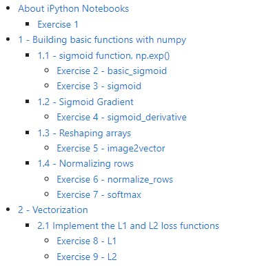
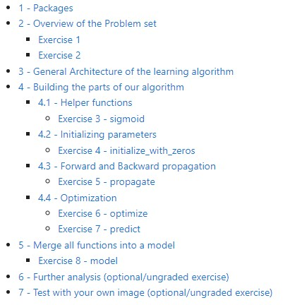
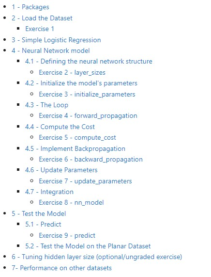
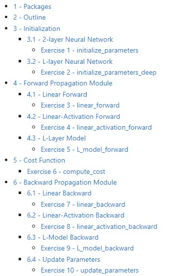
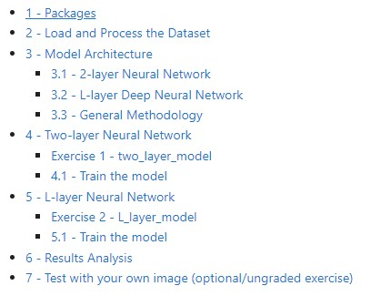

# Neural Networks and Deep Learning (Coursera Course 1)

Completed programming assignments from **Course 1** of the [Deep Learning Specialization](https://www.coursera.org/specializations/deep-learning) on Coursera (*Neural Networks and Deep Learning*, deeplearning.ai / Andrew Ng).

This repository is a coursework portfolio: NumPy-based implementations of logistic regression and neural networks, written and verified inside the course Jupyter notebooks. It is **not** a production library or deployable application.

## Problem and motivation

The course builds deep learning foundations from first principles—without high-level frameworks such as TensorFlow or PyTorch. Each assignment asks you to implement the math (forward/backward propagation, cost, gradient descent) and apply it to classification tasks, so the learning signal is clear before moving to larger toolkits.

## What is implemented

All graded exercises in Weeks 2–4 are filled in and pass the notebook unit tests (`public_tests.py`). Saved cell outputs show successful training runs.

| Week | Assignment | What you implement | Task / data |
|------|------------|--------------------|-------------|
| 2 | [Python Basics with NumPy](Week2/W2A1/Python_Basics_with_Numpy.ipynb) | Vectorized `sigmoid`, derivatives, reshaping, normalization, softmax, L1/L2 | NumPy practice (optional assignment) |
| 2 | [Logistic Regression with a Neural Network mindset](Week2/W2A2/Logistic_Regression_with_a_Neural_Network_mindset.ipynb) | Sigmoid, zero init, propagate, optimize, predict, full `model` | Cat vs non-cat images (HDF5) |
| 3 | [Planar data classification with one hidden layer](Week3/W3A1/Planar_data_classification_with_one_hidden_layer.ipynb) | Layer sizes, init, forward/backward, cost, updates, `nn_model`, predict | Synthetic 2D “flower” dataset |
| 4 | [Building your Deep Neural Network: Step by Step](Week4/W4A1/Building_your_Deep_Neural_Network_Step_by_Step.ipynb) | 2-layer and *L*-layer init, linear/activation forward & backward, cost, parameter updates | Modular DNN building blocks |
| 4 | [Deep Neural Network — Application](Week4/W4A2/Deep%20Neural%20Network%20-%20Application.ipynb) | `two_layer_model`, `L_layer_model` training loops using those blocks | Same cat vs non-cat dataset |

**Week 1** has lecture slides under [`course_slides/`](course_slides/) only; there is no Week 1 programming assignment in this repo.

### Distinction: student work vs course materials

| Present in the repo | Role |
|---------------------|------|
| Code between `YOUR CODE STARTS HERE` / `YOUR CODE ENDS HERE` in the notebooks | Student implementations |
| `*_utils.py`, `public_tests.py`, `test_utils.py`, `testCases*.py`, datasets, images, notebook prompts | Course scaffolding and tests |
| [`course_slides/`](course_slides/), [`course-content/`](course-content/) | Reference slides and assignment overview screenshots |

Helper modules such as `dnn_app_utils_v3.py` already contain a full DNN stack used by the Week 4 application notebook; the graded work there is wiring that stack into the training loops.

## Key results (from saved notebook outputs)

Results below come from executed cells already stored in the notebooks. Re-running with different seeds, package versions, or hyperparameters can change numbers slightly.

| Model | Dataset | Reported performance |
|-------|---------|----------------------|
| Logistic regression | Cat vs non-cat (209 train / 50 test, 64×64 RGB) | Train ≈ **99.0%**, test **70%** |
| sklearn logistic regression baseline | Planar flower data | **47%** accuracy |
| 1-hidden-layer NN (tanh + sigmoid) | Planar flower data | **90%** accuracy (≈91% with 5 hidden units in the hyperparameter sweep) |
| 2-layer NN `[12288 → 7 → 1]` (ReLU + sigmoid) | Cat vs non-cat | Train ≈ **100%**, test **72%** |
| 4-layer NN `[12288 → 20 → 7 → 5 → 1]` | Cat vs non-cat | Train ≈ **98.6%**, test **80%** |

## How it works (technical level)

All models are trained with **batch gradient descent** in NumPy. Typical pipeline:

1. **Load / shape data** — images flattened to column vectors and scaled to \([0, 1]\); planar points stay 2D.
2. **Initialize parameters** — zeros for logistic regression; small random weights (`* 0.01`) and zero biases for neural nets.
3. **Forward propagation** — linear transform then activation (`sigmoid`, `tanh`, or `ReLU` depending on the assignment).
4. **Cost** — binary cross-entropy.
5. **Backward propagation** — analytic gradients via the chain rule; caches store intermediates for the backward pass.
6. **Update** — \(W \leftarrow W - \alpha\, dW\), \(b \leftarrow b - \alpha\, db\).
7. **Predict** — threshold sigmoid outputs at 0.5.

Week 4 separates concerns into reusable helpers (linear forward/backward, activation forward/backward, *L*-layer model forward/backward), then composes them in the application notebook.

```text
Input X
  → [LINEAR → ReLU] × (L − 1)
  → LINEAR → SIGMOID
  → binary cross-entropy cost
  → backprop + gradient descent
```

## Technology stack

| Component | Use in this repo |
|-----------|------------------|
| **Python 3.7** (notebook metadata / `__pycache__`) | Runtime used when assignments were completed |
| **Jupyter Notebook** | Assignment environment |
| **NumPy** | Vectorized linear algebra and model math |
| **Matplotlib** | Cost curves, decision boundaries, image display |
| **h5py** | Load `train_catvnoncat.h5` / `test_catvnoncat.h5` |
| **SciPy**, **Pillow** | Optional own-image prediction demos |
| **scikit-learn** | Week 3 logistic-regression baseline and extra toy datasets |

There is no `requirements.txt` or environment lockfile in the repository. Deep learning frameworks (TensorFlow, PyTorch, Keras) are **not** used.

## Skills demonstrated

- Implementing logistic regression and shallow/deep NNs from equations in vectorized NumPy
- Forward and backward propagation, binary cross-entropy, and gradient descent
- Shape discipline for batched examples \((n_x, m)\) and parameter matrices
- Comparing linear vs non-linear models on non-linearly separable data
- Composing modular DNN layers and applying them to image binary classification
- Using provided unit tests to validate numerical correctness

## Repository structure

```text
Coursera-DL-and-NNs/
├── README.md
├── course-content/          # Assignment overview screenshots
├── course_slides/           # Course 1 lecture PDFs (weeks 1–4)
├── Week2/
│   ├── W2A1/                # NumPy basics notebook + tests
│   └── W2A2/                # Logistic regression + cat/non-cat HDF5 data
├── Week3/
│   └── W3A1/                # One-hidden-layer planar classifier
└── Week4/
    ├── W4A1/                # Step-by-step deep NN helpers
    └── W4A2/                # Image-classification application
```

Each assignment folder typically includes:

- One `.ipynb` notebook (graded implementations)
- `public_tests.py` / `test_utils.py` (and sometimes `testCases*.py`)
- Optional `*_utils.py` helpers and `datasets/` / `images/`

## Installation and setup

1. Clone the repository:

```bash
git clone https://github.com/JavadZandiyeh/Coursera-DL-and-NNs.git
cd Coursera-DL-and-NNs
```

2. Create a virtual environment (recommended) and install dependencies:

```bash
python3 -m venv .venv
source .venv/bin/activate   # Windows: .venv\Scripts\activate
pip install notebook numpy matplotlib h5py scipy pillow scikit-learn
```

3. Start Jupyter and open an assignment notebook:

```bash
jupyter notebook
```

Open, for example, `Week2/W2A2/Logistic_Regression_with_a_Neural_Network_mindset.ipynb`. Run cells **from the top** of that notebook so relative imports and `datasets/` paths resolve (notebooks expect to be run with their own folder as the working directory).

### Configuration and environment variables

No environment variables or config files are required. Hyperparameters (learning rate, iteration count, layer sizes) are set as constants inside each notebook.

## Usage

- **Study / verify an assignment:** open the notebook, run all cells; graded functions call `*_test(...)` from `public_tests.py`.
- **Cat vs non-cat models (W2A2, W4A2):** training uses the bundled HDF5 files under each assignment’s `datasets/` folder. Optional cells load a personal image via Pillow for a single prediction.
- **Planar classifier (W3A1):** data is generated in `planar_utils.load_planar_dataset()`; decision boundaries are plotted with Matplotlib.

There is no CLI, REST API, or package install entry point beyond running the notebooks.

## Testing

Automated checks are the course-provided notebook tests. After implementing a function, the following cell typically calls something like `sigmoid_test(sigmoid)` or `L_layer_model_test(L_layer_model)`. Saved outputs in this repo show **All tests passed** for the graded exercises.

There is no separate `pytest` / CI suite.

## Assignment screenshots

Overview images from [`course-content/`](course-content/):

### Week 2 — Python Basics with NumPy



### Week 2 — Logistic Regression with a Neural Network mindset



### Week 3 — Planar data classification with one hidden layer



### Week 4 — Building your Deep Neural Network



### Week 4 — Deep Neural Network for Image Classification



## Limitations and notes

- **Educational scope:** small datasets, from-scratch NumPy models, fixed hyperparameters from the course—not tuned for production accuracy or scale.
- **Course materials:** notebooks, tests, datasets, and slides belong to the Coursera / deeplearning.ai course; this repo documents personal completion of the assignments.
- **No Week 1 code:** only slides are present for Week 1.
- **Environment:** completed with Python 3.7.6 per notebook metadata; newer Python/NumPy versions may need minor adjustments.
- **No license file:** the repository does not include a `LICENSE`; respect Coursera’s terms for redistributing course content.
- **Not included:** Courses 2–5 of the specialization, GPU training, or framework-based implementations.

## Attribution

Programming assignments and supporting materials are from the Coursera Deep Learning Specialization, Course 1: *Neural Networks and Deep Learning* (deeplearning.ai).
